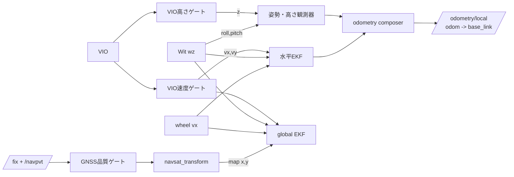

# pm_localization：オフロード向け自己位置推定

`pm_localization`は、車輪・Wit IMU・OpenVINS VIO・GNSSを用いる
Patasmonkeyの自己位置推定用ノード群です。従来互換の`legacy`構成に加え、
VIO破綻や未校正の磁気yawが水平位置を汚染しにくい
`separated_offroad`構成を提供します。

## 運用構成



### local odometry

水平EKFは`/wheel/odometry`の`vx`、`/wit/imu`の`wz`、および正常期間だけを
通すVIO `vx/vy`を使用します。VIO pose・VIO z・Witの連続磁気yawは使いません。
roll/pitchはWit orientationから、zは品質通過VIO zから別に観測し、
`local_odometry_composer_node`が`/odometry/local`へ合成します。

高さゲートが閉鎖された後も`/odometry/local_vertical`は出力を継続しますが、
これは最後に検証済みのzを保持しているだけです。新しいVIO zの追従やIMU加速度の
二重積分は行いません。

### headingとGNSS

単一GNSSアンテナは停止時headingを測れません。`heading_initializer_node`は
`/wit/mag_corrected`を`/wit/imu`のroll/pitchで水平化し、`pm_config`の真北
offsetを適用して、ROS ENU yaw（東0°、反時計回り正）を求めます。現行URDFの
IMUとbaseの軸一致を確認できないと初期化を待ちます。磁気補正は暫定値で、
回転・傾斜・実走行中の精度は未検証です。偏角を二重に加算しないでください。

新鮮な車輪前後・旋回速度とIMU角速度から停止を確認した後、既定1秒の安定化を
経て1秒の方位を円平均します（平均窓の上限3秒）。車輪情報がない場合は待機します。
平均には最低100組の磁気・IMUサンプルが必要で、条件を満たすまで待機します。
local/global EKFの`set_pose` serviceを分けて呼び、応答とそれぞれの出力yawを
確認します。姿勢の位置とroll/pitchは最新出力を保持しますが、robot_localizationの
仕様によりset_poseは内部の速度等をリセットするため、初期化中は静止が必要です。
途中で動いたり停止情報が途絶えた場合はERRORを表示し、localizationの再起動を
要求します。初期化後のyawは連続磁気方位を直接融合せず、各EKFの入力で更新します。

GNSS datumは方位を東向きのENU座標軸として設定し、車体方位と混同しません。
GNSS変換後の出力と、fromLLの東・北方向の変換を確認してから
`/odometry/gps`をglobal EKFへ渡します。navsatが初期に仮datumで
出力した値はglobal EKFに渡しません。初期化中は車体を静止してください。
`/localization/initialization/status`に状態と理由を1 Hzで発行し、GUIの姿勢欄と
mission bagにも記録します。`READY`は処理の成立を示し、暫定磁気校正の絶対精度を
保証するものではありません。状態表示は走行指令を自動遮断しません。
GNSS fixは時間制限なく待ち、fix受信後のdatum service待ちは既定5秒です。
datum応答後の変換出力と`/fromLL`は既定30秒待ち、期限切れには不足項目を表示します。
待ち時間は`heading_initializer.yaml`の`service_timeout_sec`と
`gps_verify_timeout_sec`で調整できます。
旧`/wit/imu/heading_calibrated`出力は互換用に残しますが、今回の初期化や
navsatには使わず、`/wit/mag_corrected`の補正を適用したものでもありません。

`gnss_fix_gate_node`は`/fix`と`/navpvt`を検査し、採用したfixだけを
`/fix/gated`へ出します。navsat_transformとdatum初期化はこのtopicだけを使用します。
RTK FIXでない解も一律には捨てず、carrier solution・`h_acc`・入力共分散のうち
最も保守的な水平共分散を付与します。

## 起動

```bash
ros2 launch pm_bringup pm_core.launch.py
```

既定が`separated_offroad`です。従来の構成は`localization_mode:=legacy`で選べます。
起動時は停止を維持し、GUIまたはstatus topicで`READY`を確認してから走行します。
GNSSは最初の連続正常3サンプルが通るまでglobal EKFへ入りません。

```bash
ros2 topic echo /localization/initialization/status
ros2 topic hz /odometry/gps
ros2 topic echo --once /gnss/fix_gate/diagnostics
```

詳細な設計図とステップ1〜5の経緯は
[`notes/codex_sessions/localization_steps_1_to_5_design.md`](../../notes/codex_sessions/localization_steps_1_to_5_design.md)
を参照してください。

## 関連設定

- `pm_config/config/ekf_local_horizontal_vio_twist.yaml`：水平EKF
- `pm_config/config/ekf_global_gnss_constrained.yaml`：GNSS拘束global EKF
- `pm_config/config/heading_initializer.yaml`：停止・平均・初期化検証条件
- `pm_config/config/hwt905_mag_calibration.yaml`：暫定磁気補正と真北offset
- `pm_config/config/gnss_fix_gate.yaml`：GNSS採否・共分散下限
- `pm_config/config/navsat_transform_heading_initialized.yaml`：datum待機型navsat

## ビルド

Foxyはホストではなく開発コンテナ内でビルドします。

```bash
docker exec --user 1000:1000 --env HOME=/tmp patasmonkey_foxy_dev bash -lc '
  source /opt/ros/foxy/setup.bash
  source /workspaces/ros2_ws/install/setup.bash
  cd /workspaces/patasmonkey_ws
  colcon build --packages-select pm_localization pm_config pm_bringup
'
```
