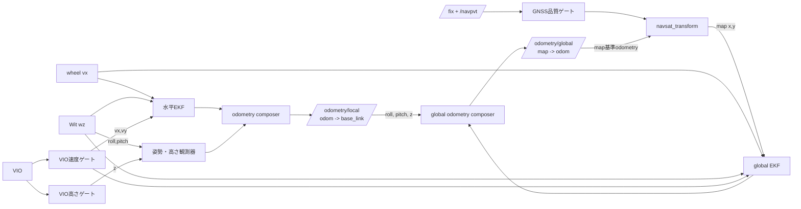

# pm_localization：オフロード向け自己位置推定

`pm_localization`は、車輪・Wit IMU・OpenVINS VIO・GNSSを用いる
Patasmonkeyの自己位置推定用ノード群です。従来互換の`legacy`構成に加え、
VIO破綻や未校正の磁気yawが水平位置を汚染しにくい
`separated_offroad`構成を提供します。

## 運用構成



### local odometry

`pm_core.launch.py`の`localization_mode`で次の５構成を選べます。既定は
`separated_offroad`のままです。後者３条件は実走採用前の比較用です。

| 値 | localの構成 |
|---|---|
| `legacy` | 従来の3D EKF設定 |
| `separated_offroad` | 現行の水平EKFと姿勢・高さ観測器 |
| `separated_projected` | 車輪・VIO速度を水平投影して水平EKFへ与える分離構成 |
| `ekf_3d_no_accel` | 3D EKF、IMU加速度を融合しない |
| `ekf_3d_accel` | 3D EKF、重力補償したIMU加速度を融合する仮設定 |

```bash
ros2 launch pm_bringup pm_core.launch.py localization_mode:=separated_projected
```

通常の`pm_core`と同様に実機機器を起動する。検証時は走行系の状態を確認する。
3D構成はwheel vx、Wit roll/pitch・3軸角速度、ゲート済みVIO vx/vy/vzとzを融合し、
初期headingとglobal GNSS構成を分離方式と共有する。VIO途絶後の鉛直状態管理、VIO
再起動後の高さ原点接続は未実装であり、加速度のbiasや共分散も未校正である。
VIO poseとtwistは同じ推定器由来であり誤差相関をEKFでは十分に扱えていない。

投影方式は`/wheel/odometry/horizontal`、`/vio/odometry/twist_horizontal`へ
水平な車体座標`base_level`における`TwistWithCovarianceStamped`を出力する。
`base_level`はbase_linkと原点・yawが共通でroll/pitchがゼロの仮想座標で、水平EKFの
入力とtarget frameとして使う。composerが最終的にbase_linkの姿勢を合成する。
Witとbase_linkの軸一致は現行URDFの前提であり、Wit frameが`wit_imu_link`以外なら
転送しない。姿勢と速度のheader時刻の差が80 msを超える場合も転送せず、件数を
`/localization/horizontal_projection/diagnostics`へ報告する。IMU姿勢共分散には
標準偏差2°の暫定下限を適用し、小角度の独立誤差近似で速度共分散へ伝播する。
車輪はvx以外をゼロと仮定し、スリップ・横移動の不確実性は表しきれない。
姿勢と速度の相関や時間ずれの不確実性も完全にはモデル化していない。
入力が古い・欠落する場合の保持や代替観測はなく、地形での真値検証も未実施。

global EKFはこれまでどおり原始車輪速度とVIO速度を使用するため、投影方式でも
global側の斜面速度補正は行わない。GNSS拘束の性能とともに後日の比較対象とする。
mission bagにはVIO、ゲート出力、投影入力・診断を記録し、core manifestに選択modeと
各設定を保存する。比較は同一の走行データをオフライン再生することも必要である。

```bash
ros2 run pm_evaluation replay_local_modes <MCAPのbagディレクトリ> <新規出力ディレクトリ>
```

同CLIは同じbagのwheel/Wit/VIO/TF staticを５つのlocal方式へ再生し、CSV、PNG、
再計算bag、3D設定、ログを残す。global EKF、磁気heading初期化、GNSS・地図や
OpenVINS自体の再計算は含まず、yawは各EKFの初期値から始まる。記録済み
`/vio/odometry`が必要で、現行mission bagには追加済み。ROS domainは`--domain`、
部分再生は`--duration`で指定する。topic配送や再生時間の偏りはlogを確認する。
通常の磁気初期化が再生中に完了できず、既知の磁気方位を仮に適用する場合は、
`--heading-yaw <ENU yaw rad> --heading-stamp <bag timestamp秒>`を同時に指定する。
各EKFの位置・roll/pitchを保持して`set_pose`でyawを一度設定する比較用の疑似初期化で、
静止判定・GNSS datum確定を代行しない。legacyはその後Wit yawを継続融合するため、
疑似初期化値が維持されるとは限らない。

水平EKFは`/wheel/odometry`の`vx`、`/wit/imu`の`wz`、および正常期間だけを
通すVIO `vx/vy`を使用します。VIO pose・VIO z・Witの連続磁気yawは使いません。
roll/pitchはWit orientationから、zは品質通過VIO zから別に観測し、
`local_odometry_composer_node`が`/odometry/local`へ合成します。

高さゲートが閉鎖された後も`/odometry/local_vertical`は出力を継続しますが、
これは最後に検証済みのzを保持しているだけです。新しいVIO zの追従やIMU加速度の
二重積分は行いません。

### global odometry

global EKFは`two_d_mode`でGNSSの水平x/y、wheel `vx`、Wit `wz`、
健全なVIO `vx/vy`を融合し、`/odometry/global_horizontal`を出します。
`global_odometry_composer_node`は同時刻に近い`/odometry/local`のroll/pitch・
相対zを合成して`/odometry/global`を出し、唯一の`map -> odom` TFを配信します。
localとglobalの時刻差が0.2秒を超える場合は、古い組合せで出力しません。
VIOが未初期化・高さgate閉鎖の間のzは保持値であり、GNSS絶対高度ではありません。
高さ不明の共分散も保持し、z=0を正確な高さとして扱いません。

VIOが未起動・隔離中はlocal EKFの横速度と横加速度が直接観測されず、
robot_localizationの予測モデルによって水平位置の共分散が増大します。
これは未知の横滑りや外力に対する不確実性であり、位置の数値そのものが発散した
ことを意味するとは限りません。Qを下げると表示される分散は減りますが、
オフロードの実際の横滑りを評価せずに信頼度を上げることはできません。
現行設定では暫定値を本番へ反映せず、VIO復帰時の速度観測と共分散を使います。

navsat transformは`/odometry/global`を基準に`map` frameのGNSS位置を出します。
localを基準にした`odom` frameのGNSSをglobalへ渡すと、global自身が出した
`map -> odom` TFで観測が移動する循環となり、発散し得ます。

### headingとGNSS

単一GNSSアンテナは停止時headingを測れません。`heading_initializer_node`は
`/wit/mag_corrected`を`/wit/imu`のroll/pitchで水平化し、`pm_config`の真北
offsetを適用して、ROS ENU yaw（東0°、反時計回り正）を求めます。現行URDFの
IMUとbaseの軸一致を確認できないと初期化を待ちます。磁気補正は暫定値で、
回転・傾斜・実走行中の精度は未検証です。偏角を二重に加算しないでください。

新鮮な車輪前後・旋回速度とIMU角速度から停止を確認した後、既定1秒の安定化を
経て1秒の方位を円平均します（平均窓の上限3秒）。車輪情報がない場合は待機します。
平均には最低100組の磁気・IMUサンプルが必要で、条件を満たすまで待機します。
local/global EKFの`set_pose` serviceを分けて呼び、応答とそれぞれの出力yawを
確認します。姿勢の位置とroll/pitchは最新出力を保持しますが、robot_localizationの
仕様によりset_poseは内部の速度等をリセットするため、初期化中は静止が必要です。
途中で動いたり停止情報が途絶えた場合はERRORを表示し、localizationの再起動を
要求します。初期化後のyawは連続磁気方位を直接融合せず、各EKFの入力で更新します。

GNSS datumは方位を東向きのENU座標軸として設定し、車体方位と混同しません。
GNSS変換後の出力と、fromLLの東・北方向の変換を確認してから
`/odometry/gps`をglobal EKFへ渡します。navsatが初期に仮datumで
出力した値はglobal EKFに渡しません。初期化中は車体を静止してください。
`/localization/initialization/status`に状態と理由を1 Hzで発行し、GUIの姿勢欄と
mission bagにも記録します。`READY`は処理の成立を示し、暫定磁気校正の絶対精度を
保証するものではありません。状態表示は走行指令を自動遮断しません。
GNSS fixは時間制限なく待ち、fix受信後のdatum service待ちは既定5秒です。
datum応答後の変換出力と`/fromLL`は既定30秒待ち、期限切れには不足項目を表示します。
待ち時間は`heading_initializer.yaml`の`service_timeout_sec`と
`gps_verify_timeout_sec`で調整できます。
旧`/wit/imu/heading_calibrated`出力は互換用に残しますが、今回の初期化や
navsatには使わず、`/wit/mag_corrected`の補正を適用したものでもありません。

`gnss_fix_gate_node`は`/fix`と`/navpvt`を検査し、採用したfixだけを
`/fix/gated`へ出します。navsat_transformとdatum初期化はこのtopicだけを使用します。
RTK FIXでない解も一律には捨てず、carrier solution・`h_acc`・入力共分散のうち
最も保守的な水平共分散を付与します。

## 起動

```bash
ros2 launch pm_bringup pm_core.launch.py
```

既定が`separated_offroad`です。従来の構成は`localization_mode:=legacy`で選べます。
起動時は停止を維持し、GUIまたはstatus topicで`READY`を確認してから走行します。
GNSSは最初の連続正常3サンプルが通るまでglobal EKFへ入りません。

```bash
ros2 topic echo /localization/initialization/status
ros2 topic hz /odometry/gps
ros2 topic echo --once /gnss/fix_gate/diagnostics
```

詳細な設計図とステップ1〜5の経緯は
[`notes/codex_sessions/localization_steps_1_to_5_design.md`](../../notes/codex_sessions/localization_steps_1_to_5_design.md)
を参照してください。

## 関連設定

- `pm_config/config/ekf_local_horizontal_vio_twist.yaml`：水平EKF
- `pm_config/config/ekf_global_gnss_constrained.yaml`：GNSS拘束global EKF
- `pm_config/config/heading_initializer.yaml`：停止・平均・初期化検証条件
- `pm_config/config/hwt905_mag_calibration.yaml`：暫定磁気補正と真北offset
- `pm_config/config/gnss_fix_gate.yaml`：GNSS採否・共分散下限
- `pm_config/config/navsat_transform_heading_initialized.yaml`：datum待機型navsat

## ビルド

Foxyはホストではなく開発コンテナ内でビルドします。

```bash
docker exec --user 1000:1000 --env HOME=/tmp patasmonkey_foxy_dev bash -lc '
  source /opt/ros/foxy/setup.bash
  source /workspaces/ros2_ws/install/setup.bash
  cd /workspaces/patasmonkey_ws
  colcon build --packages-select pm_localization pm_config pm_bringup
'
```
