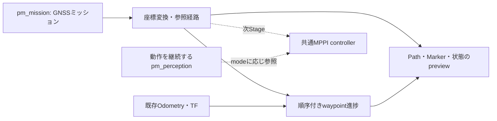

# pm_planner：準備・Stage 1

## UGV側の実行管理

`pm_core.launch.py`は`/pm/planner/execution_manager`も起動します。
MISSION PLANNERは既存の`/pm/mission/upload`へ経路を送り、`pm_mission`の受信箱は
保存成功後に`/pm/mission/accepted`を発行します。実行管理は内容とhashを再検証し、
受領したmissionを保持します。受信箱の再起動時も保存済みの最後の経路を再検証して復元します。
地理座標の経路を受領した状態と、参照Path生成・走行準備の完了は別です。

GUIの「自律走行 開始／終了」は実行管理の`~/start`／`~/stop`（Trigger）に要求します。
**MPPI未接続の現在、開始は必ず理由付きで拒否し、車両の自律指令を許可しません。**
終了は`/pm/vehicle/set_autonomy_enabled`にfalseを非同期送信します。
サービスの受付は車両の停止完了を意味せず、GUIには車両の許可状態と鮮度を別に表示します。
車両側サービスが無い場合の終了要求は失敗を表示します。手動走行とCoreの操作は別です。

GUI右上の地図には、実行管理が保持するhashと一致した受領waypointを橙破線で表示します。
これはWGS84の元折線で、車両の実績軌跡や生成済み補間Pathではありません。
地理地図の表示には有効なGNSS fixが必要です。実行管理が停止・staleになった場合は消します。

残りの段階では、受領missionをplannerの地理変換・Path生成へ接続し、controllerの準備状態、
手動介入時の状態遷移、実際の自律有効化・停止応答の確定を実装します。
現時点ではGUI・実行管理から自律走行の開始はできません。

GNSSミッションをメートル単位の参照経路に変換し、位置入力からwaypointの
進捗を確認するPythonパッケージです。**Stage 1は非駆動previewです。**
`start`サービスも追跡状態を開始するだけで、車両を動かしません。
速度publisher、TF broadcaster、MPPI、障害物回避、GUI mode切替はまだありません。
perception・localization・motorの既存launchは変更も起動もしません。

## 責務と今後の構成



Stage 1の範囲は`pm_planner`一つに収め、ROS接続と純Python計算を分離しました。
`geodesy.py`が座標、`reference.py`が幾何経路、`progress.py`が進捗を担当します。
`preview_node.py`はROS I/O、`cli.py`はROSなしの確認用です。
将来の3 mode（経路追従のみ／障害物で停止／障害物回避）は共通MPPIを使う予定です。
perceptionを無視するmodeでもperceptionそのものは停止しません。

## ビルド

開発PCホストではなくFoxyコンテナ内で実行します。

```bash
cd /workspaces/patasmonkey_ws
source /opt/ros/foxy/setup.bash
source /workspaces/ros2_ws/install/setup.bash
colcon build --symlink-install --packages-select pm_planner
source install/setup.bash
```

`pm_mission`・`pm_config`が未ビルドなら先にビルドしてください。
毎ターミナルでROS→外部workspace→本workspaceの順にsourceします。

## まず実機なしで表示する

同梱ミッションは実在路面の走行許可を意味しない、形状確認用の架空経路です。

```bash
ros2 launch pm_planner preview.launch.py \
  mission_file:=/workspaces/patasmonkey_ws/src/pm_planner/examples/demo_mission.yaml \
  coordinate_mode:=manual \
  anchor_file:=/workspaces/patasmonkey_ws/src/pm_planner/config/home_preview_anchor.yaml \
  rviz:=true
```

RVizのFixed Frameは`planner_preview`です。左側のDisplaysで変更できます。
グレー線が元waypointの折れ線、青線が幾何条件を通った参照Path、文字が属性です。
有効なOdometryを購読した場合は自車矢印と目標waypointも表示します。
TFがなくても、この専用frame内の経路単体は表示できます。

ROSもRVizも使わずSVGとJSONを保存する場合：

```bash
ros2 run pm_planner preview_mission \
  /workspaces/patasmonkey_ws/src/pm_planner/examples/demo_mission.yaml \
  --anchor /workspaces/patasmonkey_ws/src/pm_planner/config/home_preview_anchor.yaml \
  --vehicle-config /workspaces/patasmonkey_ws/src/pm_config/config/vehicle_control.yaml \
  --output /tmp/planner_demo_preview
```

出力先は新規ディレクトリを指定します。`reference.svg`をブラウザ等で開き、
`summary.json`でanchor・元ミッション・制約・補間点を確認できます。
同じコマンドのmissionを`src/pm_mission/missions/home.yaml`へ替えると、
5番目の鋭い折返しも対称3円弧で接続します。該当箇所の拡大図は`turn_005.svg`です。
以前の拒否方針との比較は`--sharp-turn-strategy reject`で実施できます。
その場合も元折れ線と拒否理由を保存します（幾何条件不成立の終了コードは2）。

## 鋭角部の対称な前進回り込み

通常の円弧filletが`corner_allowance_m`またはPASSの到達半径に収まらないとき、
`sharp_turn_strategy: symmetric_bulb`では元waypointを通る3円弧へ切り替えます。
すべて前進で、切り返しやその場旋回は行いません。

左折返しでは「右へ小さく膨らむ→大きく左旋回→右へ小さく戻す」と接続し、
右折返しではその鏡像にします。主旋回と、入口・出口での小さな逆方向旋回を
合わせた正味のheading変化が元の折曲角です。単に大きな単一円弧へ置き換える方式とは異なります。

全円弧の半径Rは共有車両設定の`min_turn_radius`です。折曲角の絶対値をβとすると、
`h=β/2`、`α=acos((1+cos(h))/2)`、`d=R*(sin(h)+2*sin(α))`を使います。
元点をB、進入・離脱の単位方向をu/vとしたとき、進入点は`B-d*u`、離脱点は`B+d*v`。
元点からの距離は両側で等しく、経路の弧長中点はBを通ります。
円弧角は左折返しの場合`-α, β+2α, -α`で、右折返しは符号が逆になります。
180°でもdは有限で、R=0.3 mなら約0.820 mです。
**dは進入・離脱の切詰め距離であり、横方向の膨らみ幅や走行回廊幅ではありません。**

正確な180°では点列だけから左右を決められないため、`uturn_direction`で指定します。
それ以外は経路の向きで決めます。隣接waypointまでが短く接続部分が重なる場合は拒否します。
PAUSE/CONFIRM等の停止属性で方向を変える接続は従来どおり未対応です。

現在の回り込みは、回廊・障害物・地形・車体footprintとの衝突を確認しません。
`corner_allowance_m`は通常filletから切り替える基準であり、3円弧の膨らみを制限しません。
`status`とCLI JSONには方式・左右・半径・切詰め距離・弧長位置を記録し、
RVizの該当ラベルにも`bulb CW/CCW R=...`を表示します。

## 設定ファイル

```bash
ros2 launch pm_planner preview.launch.py \
  config:=/workspaces/patasmonkey_ws/src/pm_planner/config/planner.yaml
```

空でない明示launch引数だけがYAMLより優先されます。
`mission_file`以外のparameterは起動時固定です。変更時はnodeを再起動してください。
`mission_file`変更後は`load`で明示再読込します。追跡中の読込は拒否します。

| parameter | 既定値 | 意味 |
|---|---:|---|
| coordinate_mode | navsat | 既存FromLL利用。manualは明示anchor利用 |
| planning_frame | map | navsat利用時の出力先frame |
| navsat_world_frame | 空 | **実際のnavsat出力frameの明示が必要** |
| navsat_service | /fromLL | 既存robot_localization座標変換 |
| navsat_odom_topic / gnss_topic | /odometry/gps / /fix/gated | frame・稼働・高度の確認入力 |
| pose_topic / base_frame | /odometry/local / base_link | 進捗判定に使う車体Odometry |
| pose_timeout_sec / gnss_timeout_sec | 0.5 / 2.5 s | ROS stampと受信後経過時間の両方で期限確認 |
| service_timeout_sec | 3 s | waypointごとのFromLL応答期限 |
| max_projection_tilt_rad | 0.05 rad | 2D座標変換で許容するTFのroll/pitch |
| spacing_m | 0.1 m | 参照経路の弧長方向の最大補間間隔 |
| corner_allowance_m | 0.3 m | 通常filletで元PASS点から離れてよい距離 |
| sharp_turn_strategy | symmetric_bulb | 通常fillet不可時の対称3円弧接続。rejectで従来の拒否方針 |
| uturn_direction | counterclockwise | 正確な180°だけの左右選択。clockwiseも可 |
| pass_radius_m / stop_radius_m | 0.5 / 0.25 m | PASS／停止属性の到達半径 |
| start_radius_m | 0.5 m | START位置からの開始許容距離 |
| heading_tolerance_rad | 0.52 rad | START時の進行方向との角度差 |
| stop_speed_mps | 0.03 m/s | Odometryで停止とみなす速度上限 |
| max_deviation_m | 1 m | 局所参照経路からの逸脱上限 |
| max_advance_m | 2 m | 1入力で探索する前方弧長の上限 |
| max_pose_gap_sec / jump_slack_m | 1 s / 0.3 m | 入力欠落上限／ジャンプ判定の位置余裕 |
| max_segment_m | 500 m | waypoint間の異常な長距離を拒否 |
| vehicle_config | pm_config共有設定 | min_turn_radius・速度・角速度・角加速度を取得 |

共有車両設定の現値は最小旋回半径0.3 m、最大速度1 m/s、最大yaw rate 1 rad/s、
最大yaw acceleration 1 rad/s²です。Stage 1では旋回半径を経路形状に適用し、
最大速度を位置ジャンプ検出に利用します。角速度・角加速度を満たす速度時間割は
まだ生成しません。円弧との接続点は曲率が不連続なので、次Stageで速度計画が必要です。

## 座標の契約：localizationの初期化とは別

manual anchorはWGS84→ECEF→ENUを使い、指定frameのXYへ回転・平行移動します。
`east_yaw_rad`はそのframeで東が向く角度であり、自車headingではありません。
`home_preview_anchor.yaml`は独立した表示基準にすぎず、実車のmapと一致しません。
zは水平Pathでは0で、waypoint高度を地形として推定する機能もありません。

実車座標に揃える場合は既存navsatの`/fromLL`を使用します。サービスの応答fieldが
`map_point`でも、その座標frameがmapとは限りません。現在のbringupはnavsatへ
`/odometry/local`を入力する構成なので、次を確認して指定してください。

```bash
ros2 topic echo /odometry/gps
# header.frame_idを確認してCtrl+Cで終了する（Foxyのechoに--onceはない）。
# header.frame_idがodomだった場合の例。既存localizationを別途起動した状態で使う。
ros2 launch pm_planner preview.launch.py \
  mission_file:=/workspaces/patasmonkey_ws/src/pm_mission/missions/home.yaml \
  navsat_world_frame:=odom planning_frame:=odom rviz:=true
```

RVizのFixed Frameも`odom`に変更します。`map`へ出す場合は観測stampでmap←odomの
TFが必要です。latest TFへfallbackしません。FromLL変換では読込開始時のTFと高度を
snapshotにし、非同期に全waypointを変換します。経路を再び座標に合わせ直すには
追跡をpauseしてreloadします。datum設定、map→odom、odom→base_linkは発行しません。
新しいGNSS・navsat出力・サービスが揃わない間はWAITINGです。
この準備確認だけで地理的整合性が実証されたとは扱わず、`drive_ready`は常にfalseです。

## node・topic・サービス

nodeは`/pm/planner/preview`です。下記はすべてその配下です。

| 出力 | 型・用途 |
|---|---|
| reference_path | nav_msgs/Path：条件を満たした補間経路（非時間パラメータ化） |
| mission_polyline | nav_msgs/Path：元waypointを直線で接続したpreview |
| markers | MarkerArray：読込時だけ生成する属性ラベル（先頭200点） |
| progress_markers | MarkerArray：目標点と車体矢印、5 Hz |
| status | std_msgs/String：JSON状態、5 Hz |

PathとMarkerはRELIABLE・TRANSIENT_LOCAL・depth=1で、RViz後起動にも対応します。
状態には元missionのID/revision/hash、座標基準、車両制約、到達済みIDを含めます。

以下は**非駆動の進捗追跡**の操作です。`start`は新しい有効pose・START付近・
停止速度・進入headingを要求します。

```bash
ros2 topic echo /pm/planner/preview/status
ros2 service call /pm/planner/preview/start std_srvs/srv/Trigger '{}'
ros2 service call /pm/planner/preview/pause std_srvs/srv/Trigger '{}'
ros2 service call /pm/planner/preview/resume std_srvs/srv/Trigger '{}'
ros2 service call /pm/planner/preview/confirm std_srvs/srv/Trigger '{}'
ros2 service call /pm/planner/preview/cancel std_srvs/srv/Trigger '{}'
ros2 service call /pm/planner/preview/reset std_srvs/srv/Trigger '{}'
# ファイル編集後に再読込する場合
ros2 param set /pm/planner/preview mission_file /absolute/path/mission.yaml
ros2 service call /pm/planner/preview/load std_srvs/srv/Trigger '{}'
```

進捗は近傍の弧長区間だけで投影し、waypoint順序を守ります。往路・復路が接近しても
遠方の経路へ飛びません。PASSは到達半径と弧長条件、GOALは停止確認も必要です。
PAUSEは停止後の`pause_sec`経過、CONFIRMは停止後のサービス確認で次へ進みます。
停止属性の点で方向が折れる経路は、暗黙のその場旋回を作らず拒否します。
古いpose／TF不成立では追跡をpauseし、新poseだけでは再開しません。
位置ジャンプ・時刻巻戻り・欠落・逸脱ではFAULTとなり、resetが必要です。
cancelは参照経路を表示したまま進捗をCANCELEDにします。再実行にはload/resetが必要です。
`STOP_REQUIRED`も通知状態にすぎず、実車の停止を実行する機能はありません。

## テストと制約

```bash
# コンテナ内、ビルド・runtime source後。実車とは別DDS domainで実施する。
ROS_DOMAIN_ID=213 ROS_LOCALHOST_ONLY=1 python3 -m pytest src/pm_planner/test -q
```

地理座標、円弧・曲率、対称回り込みと従来の拒否方針、順序・停止・確認、欠落・巻戻り、ROSサービスと
Path発行をテストします。実車走行・実GNSS座標の精度はこのテストでは保証しません。
障害物・敷地境界・車体footprintに対する衝突検証もまだありません。

次Stageでは座標整合の実測確認、回り込みの運動・環境条件の検証、Foxy向けMPPIの
切出し／互換性検証、速度時間割、停止・手動優先・入力期限切れの制御契約を固めます。
その後にperception costとの接続と3 modeのGUIを追加します。
