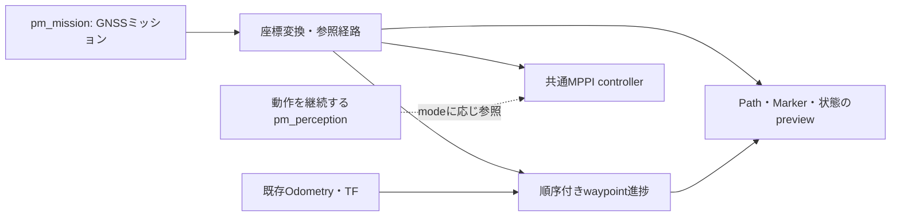

# pm_planner：経路生成・MPPI・自律実行管理

## home.yamlを使うMPPIのリアルタイム可視化

`mppi_live_demo`はMISSION PLANNER形式の経路を読み、生成した参照Pathへ
仮想車体を閉ループで追従させるデモです。各周期にMPPIが候補を評価し、
採用した速度から点車体の位置・向きを更新します。GUIや実機の起動は不要です。
専用の仮想frame `planner_preview`・`mppi_demo_base`を使い、実機の位置推定や
`/cmd_vel`・`/cmd_vel_autonomy`には接続しません。障害物は評価しません。

Foxy・外部workspace・本workspaceを順にsourceした端末で実行します。

```bash
source /opt/ros/foxy/setup.bash
source /workspaces/ros2_ws/install/setup.bash
source /workspaces/patasmonkey_ws/install/setup.bash
ros2 launch pm_planner mppi_live_demo.launch.py
```

青はwaypointから生成した参照Path、緑は仮想車体の走行軌跡、橙は現時点の
採用予測軌道、灰色は評価した候補の一部です。水色の箱は車体の概形、矢印は
車首方向で、箱の長さ0.65 mは表示用の仮値です。RVizは仮想車体を追従します。
`home.yaml`は既定でinstall済みの`pm_mission/missions/home.yaml`を読みます。
基準座標は`config/home_preview_anchor.yaml`の仮基準で、実機のmapとの重ね合わせはできません。

別のmissionや倍速表示は起動引数で指定できます。倍速では計算機が処理に追いつかない
場合、指定倍率より遅くなります。`/clock`は変更せず、仮想車体の時間だけを進めます。

```bash
ros2 launch pm_planner mppi_live_demo.launch.py time_scale:=10.0
ros2 launch pm_planner mppi_live_demo.launch.py mission_file:=/absolute/path/to/mission.yaml
```

`config/mppi_live_demo.yaml`で候補数・予測長・速度・倍速・表示候補数などを変更できます。
`reference_turn_margin_m`は車両の最小旋回半径に足す参照Pathの余裕で、既定は0.1 mです。
車両の設定が0.3 mなら参照Pathは0.4 m、MPPIの車体制約は0.3 mのままです。
候補表示は`candidate_sample_count: 0`で無効化できます。YAMLの変更は再起動後に反映します。
独自基準を使うときは`anchor_file:=/absolute/path/to/anchor.yaml`を指定し、RVizのFixed Frameも
そのframeに合わせます。中間のPAUSE／CONFIRM属性には未対応で、無視せず起動を拒否します。

別端末では進捗・計算時間の確認と一時停止・再開・初期化ができます。

```bash
ros2 topic echo /pm/planner/mppi_demo/status
ros2 service call /pm/planner/mppi_demo/pause std_srvs/srv/Trigger '{}'
ros2 service call /pm/planner/mppi_demo/resume std_srvs/srv/Trigger '{}'
ros2 service call /pm/planner/mppi_demo/reset std_srvs/srv/Trigger '{}'
```

`compute_ms`はMPPI計算だけの時間です。仮想車体は簡易モデルであり、実機の走行性能・
安全性を保証するものではありません。実位置での非駆動確認は下記`mppi_poc`を使います。

## MPPI非駆動PoC

`mppi_poc`は参照Pathと同一frameのOdometryを読み、複数の速度候補を予測・評価する
Python／NumPyの試験nodeです。発行するのは`/pm/planner/mppi_poc/debug/`配下の
`cmd_vel`（Twist）、`trajectory`（採用予測Path）、`status`（JSON）だけです。
このdebug nodeは`/cmd_vel_autonomy`には接続しません。実車向け接続は後述のexecution_managerが担当します。

前進・旋回の候補を正規分布で生成し、各候補の各stepで車体速度、yaw rate、
加速度と最小旋回半径を制約したうえで位置を予測します。参照Pathの前方点までの
距離・向き・目標速度などのcostからsoftmax重みを作り、候補入力の重み付き平均を
次の指令とします。前回の解を次回へ持ち越し、Pathが変われば初期化します。
往復路が近い場合に復路へ飛ばないよう、最近傍探索を現在の進捗周辺に限定します。
これは独立実装のPoCで、Nav2 MPPIとの数値一致や同等の性能を保証しません。
制約が競合する場合は最後に最小旋回半径・停止を優先するため、yaw加速度上限を
常に満たす保証はありません。

`config/mppi_poc.yaml`で`rate_hz`、候補数`batch_size`、予測step数`steps`、
反復数`iterations`、乱数seed、速度・角速度のばらつき、lookahead等を設定します。
参照点距離・方位・速度・yaw速度・末端距離のcost重みも同じYAMLで調整できます。
ROS launchの既定は10 Hz、384候補、25 step、2反復、target_speed 1.0 m/sです。
`use_reference_speed_profile: true`では曲率とyaw制約に応じた参照速度をPath更新時に
計算します。カーブ手前・終点へ向けて減速し、直線へ戻った後も前後加速度を
守れる速度推移で先の参照点を選びます。速度costも同じ時刻の参照速度に合わせます。
`false`は従来の一定速度参照との比較用です。参照速度は目標であり、実出力の
瞬間的な速度上限ではありません。最終指令はMPPIとvehicle interfaceの制約に従います。
曲率変化部のyaw加速度は離散Pathからの近似で、実interface全体の厳密再現ではありません。
最小旋回半径・最大速度・yaw速度／加速度の上限は共有`vehicle_control.yaml`から読みます。
これらは車体側の制約としてそのままMPPIへ渡し、`skid_steer_yaw_efficiency`を
掛けません。輪距や旋回効率による半径の暗黙の拡大も行いません。
最大速度は全体・自律・直進車輪上限の最小です。制限無効化の0設定はPoC未対応で拒否します。
実interfaceの曲率に応じた滑らかな減速・過渡応答・旋回時の車輪上限までMPPIが
完全再現するわけではありません。評価器では実interfaceの数値処理を人工車体の前段に入れます。
既定のsymlink-installでは`install`内の設定が`src/pm_config/config/vehicle_control.yaml`へ
リンクされるため、値の変更に再ビルドは不要ですがnodeの再起動が必要です。明示した
`vehicle_config`や他のoverlayを使う場合は、その参照先が優先されます。
parameterは起動時に読み取り、変更反映にはnodeの再起動が必要です。
`visualize: false`で予測Path messageの生成・publishを止められます。

### スキッドステア旋回応答の実験設定

`yaw_response_gain`は指令yaw rateに対する予測車体yaw rateの倍率です。
候補生成・速度指令の制約は従来どおりで、予測のyaw積分だけに係数を適用します。
既定値1.0は、vehicle interfaceが車体の速度指令を実現するという仮定です。
vehicle interfaceの輪差補正は実装済みですが、実機の応答精度は別途検証が必要です。0.5の設定は
旧bagでの未補正状態を模擬する実験用です。低速0.15 m/sや他の路面、左右差、
過渡応答は未検証です。角加速度制約には
実測値と区別した前回指令を使用します。起動時・異常時は指令をゼロに戻します。
この仮値を実車指令へ接続しないでください。

```bash
ros2 launch pm_planner mppi_live_demo.launch.py config:=/workspaces/patasmonkey_ws/src/pm_planner/config/mppi_live_skid_experiment.yaml
```

上の設定は予測と仮想車体の両方を0.5にします。`sim_yaw_response_gain`は
仮想車体側のみ、`yaw_response_gain`は予測側のみの設定で、独立に変更できます。
人工車体側を変更するだけでは実車の検証になりません。実効旋回半径も大きくなるため、
従来の0.3 m半径の参照経路を追従できないことがあります。

### 人工閉ループで試す

Foxyの各overlayをsourceしてから、未作成の出力directoryを指定します。

```bash
ros2 run pm_planner mppi_sim --output /tmp/mppi_demo
```

点車体modelが予測指令に反応する4経路（直線、曲線、折返し、近接往復）を評価し、
各`*.svg`に青い参照経路と橙の人工軌跡、`*.csv`に各時刻の座標・速度・弧長を保存します。
`summary.json`には終点到達、既存waypoint進捗判定の結果、参照折線の線分への最大最近傍距離と
計算時間分布があります。このスクリプトの進捗判定は検証用です。実行管理も同じProgressを使用します。
自己交差付近では異なる区間への距離が最小になるため、実際の追従区間の誤差を過小評価し得ます。
この人工simulationは共有車両設定の初期値相当を使い、実機の地理座標には接続しません。

### ROS topicを使って確認する

既存previewまたはCoreがPathをpublishし、同じframeのOdometryがある状態で、別端末から
以下を実行します。Coreやbag再生をこのlaunchが起動することはありません。

```bash
ros2 launch pm_planner mppi_poc.launch.py rviz:=true
ros2 topic echo /pm/planner/mppi_poc/debug/status
```

RVizで青が参照Path、橙が現在poseからの予測軌道です。Fixed Frame既定はmapです。
Odometry入力は既定`/odometry/global`（map）で、変更は`mppi_poc.yaml`で行います。
PathとOdometryのframeが一致しない場合はゼロ指令をdebug publishし、理由をstatusに出します。
TF変換は未対応です。timestamp・受信時間の両方でOdometryの期限を確認します。
`use_sim_time:=true`はbagのclock使用時に指定します。

statusの`compute_ms`はoptimizerと入力検査の時間で、publish・描画やcallback待ちを含む
end-to-end時間ではありません。`p95_ms`・`max_ms`は直近最大300回の同じ計算時間で、
入力未受信など計算できなかった周期の短い処理時間も含みます。
Jetsonでの実行時間・CPUや受信間隔は別途計測します。

障害物・perception・unknown、車体footprint、PAUSE／CONFIRM waypointでの停止、後退は未対応です。
このdebug node自体は実行管理の速度出力へ接続しません。実行管理の接続は後述します。終点近傍ではdebug指令を
即時ゼロにし、実車向けの減速軌道を生成しません。vehicle_interfaceの制限モデルを
完全に再現するものではなく、候補軌道の妥当性・実機追従を保証しません。
予測dtは設定した周期の固定値で、callback遅延を実時間で補正しません。

## UGV側の実行管理と速度出力

`pm_core.launch.py`は受信箱、`planner_preview`、`execution_manager`を起動する。
起動・mission受領では自律走行を開始しない。既存のpm_drive/車両走行許可と、
GUIの自律開始は別の操作。車両が接続・armed・非緊急停止であることが必要。

```mermaid
flowchart LR
  U[MISSION PLANNER: GNSS mission送信] --> R[pm_mission受領・保存]
  R --> E[実行管理: IDとhash検証]
  E --> G[preview: FromLL・補間・Path]
  G --> F[RouteFollower: 進捗・曲率参照速度・MPPI]
  O[同じframeのOdometry] --> F
  F --> A[実行管理の有効化ゲート]
  Q[GUI開始・終了とheartbeat] --> A
  V[車両許可と手動介入] --> A
  A --> C[/cmd_vel_autonomy]
  C --> I[vehicle interface: 指令選択・車両制約・モータ変換]
  I --> B[/cmd_vel: 採用後の車体指令]
```

Core用の設定正本は`src/pm_config/config/planner.yaml`。単独起動の既定は
`pm_planner/config/planner.yaml`の独立コピーを使う。最小半径・yaw速度・加速度は
共通vehicle_control.yamlから読む。既定の目標速度1 m/s、10 Hz、曲率参照速度有効。
参照Path半径には`reference_turn_margin_m`を加える。

### 開始・停止の契約

開始サービスは準備不足なら理由付きで拒否する。受領missionとpreviewのID/revision/hash、
Path hash、frame、poseのstampと受信鮮度、GUI heartbeat、車両の接続・armed・緊急停止を検査する。
開始を受け付けた後はSTARTINGで車両のSetBool応答とstatusの自律許可ONを待ち、
両方を確認してからRUNNINGとなる。受付応答は車両が走り出したことを意味しない。

手動Twistはゼロを含めて介入とし、GUI終了、緊急停止、入力・状態の期限切れ、
制御周期超過、frame不一致、経路の更新、進捗FAULTでも速度を無効化する。
復旧・Joy途絶・GUI再接続だけでは再開せず、GUIの明示開始が必要。
通常の手動中断は進捗を保持して再開可能、進捗FAULTや完了後の再実行はmission再受領等で
Pathを再生成する。新規経路はSTART付近・停止・向き一致を要求し、自動接続は行わない。

#### GUI停止・Joy介入後の明示再開

同じmissionのまま自律開始を押すと、停止前の進捗より前方の経路全体に現在位置を
再投影する。従来の約2 mの局所探索に制限せず、手動で先行した区間のPASSは
通過済みと推定する。`progress.inferred_completed_waypoint_ids`で実走行時の到達確認と
区別する。これは手動走行の軌跡が各waypointを通った証明ではない。
GOALは推定で消化せず、終点での停止確認を残す。終点を通り越して停止半径外へ出た場合は、
暗黙の折返しを作らず再開を拒否する。MPPIも新しい弧長に合わせて初期化する。

再開時は停止速度以下、yaw rate 0.05 rad/s以下、経路との距離4 m以下、接線との
heading差0.52 rad以下を要求する。距離最短の候補と0.15 m以内の差で別の区間が
残り、弧長が1 m以上離れていれば、交差・近接区間の曖昧さとして拒否する。
検査に失敗しても進捗は変更せず、距離・向きを直して明示開始をやり直せる。
初回開始は従来どおりSTART付近のみ。完了・進捗FAULTからの再実行にはmission再受領が必要。

自己位置は手動停止中も監視する。pose共分散のXY最大標準偏差1 m、yaw標準偏差0.5 radを
超える入力、非有限・不正共分散、期限切れ・frame不一致は拒否する。
連続poseの位置変化が`最高速度×dt + 0.3 m`、向き変化が
`最高yaw rate×dt + 0.2 rad`を超える場合、時刻巻戻り、同一stampで位置・向きが変わる場合は
異常を保持し、入力が戻っただけでは解除しない。localizationを確認・修復してからmissionを
再受領する。単なる経路reloadではこの異常を解除しない。
共分散全ゼロは品質不明として許容するため、これらの検査だけで緩やかなドリフトや
誤った低共分散を検出できる保証はない。長い観測欠落中の移動も完全には判別できない。

しきい値は`planner.yaml`の`resume_ambiguity_*`、`resume_max_yaw_rate`、
`pose_max_position_std_m`、`pose_max_yaw_std_rad`、`pose_jump_slack_m`、
`pose_yaw_jump_slack_rad`で設定する。走行中の通常進捗判定は局所探索のまま維持する。

車両許可のtrue/false要求は直列化し、停止後に遅いtrue応答が来ても非ゼロ出力を再開しない。
車両側の許可解除が遅い/失敗してもplannerはゼロを継続し、解除を再試行する。
plannerプロセス消失時は既存vehicle interfaceの受信タイムアウト（0.3秒）が停止を担当する。
Twist自体には送信stampがないため、DDS内の滞留時間を受信側だけで完全に判定はできない。

Operator ConsoleはQt更新が継続している間だけheartbeatを発行する。ROS threadのみが
生きているGUI停止ではheartbeatも止まる。GUI更新の判定窓1秒とmanagerのoperator期限1.5秒が
あるため、Qt停止検出は合計で最大約2.5秒の猶予を持つ。運用条件に応じた見直しが必要。

| parameter | 既定 | 意味 |
|---|---:|---|
| controller_rate_hz | 10 | MPPI・自律指令の最大更新Hz |
| target_speed | 1.0 | 直線の目標m/s。旋回・終点では参照速度を落とす |
| pose_timeout_sec | 0.5 | stampと受信の両方で自己位置の期限を検査[s] |
| command_timeout_sec | 0.3 | 制御周期と計算結果の期限[s] |
| operator_timeout_sec | 1.5 | GUI heartbeatの受信期限[s] |
| vehicle_timeout_sec / preview_timeout_sec | 1.5 / 1.5 | 状態の受信期限[s] |
| permission_timeout_sec | 2.0 | 車両の自律許可確認期限[s] |

### topicとトラジェクトリ

| topic | 内容 |
|---|---|
| /pm/planner/preview/reference_path | GNSS missionから生成したグローバルPath |
| /pm/planner/preview/reference | Pathとイベント・座標根拠・mission/Path hashを同梱したsnapshot |
| /pm/planner/execution_manager/local_path | MPPIの採用予測位置列、nav_msgs/Path |
| /pm/planner/execution_manager/trajectory | 同じ予測の時刻・x/y/yaw・v/w、std_msgs/StringのJSON |
| /pm/planner/execution_manager/status | DISABLED/STARTING/RUNNING/WAITING/FAULT/COMPLETED、理由・進捗・車両許可 |
| /cmd_vel_autonomy | 有効時の自律Twist。無効時はゼロ |

`trajectory.points`はtime_from_start_sec[s]、x/y[m]、yaw[rad]、v[m/s]、w[rad/s]を持つ。
既定25 step×0.1秒で2.5秒先まで。Path messageだけでは速度・時刻間隔を保持できないので、
JSONにも同じ予測を出す。これはMPPIの予測で、実車が必ずその軌跡になるという保証ではない。
現在の最適化では位置・向き・速度を一緒に選び、先頭の速度指令を毎周期更新する。
別の局所Path追従器へ渡してさらに速度を計算する二段構成ではない。

Core既定の非legacyはmapの/odometry/global、legacyはodomの/odometry/localを使う。
FromLLの出力frameをpreviewで照合し、controllerはPathと同じframeのOdometryのみ受ける。
暗黙のlatest TF変換は行わない。localizationの初期化・datum・TFは変更しない。
manual anchorはalignment_verified=trueがない限り開始用Pathとして拒否する。
実際のGNSS地図との精度・走行性能は実機では未検証。

GUI右上の橙破線はhash一致した受領GNSS waypointの元折線。補間PathやMPPI予測とは区別する。
補間Path・ローカルPathはRVizで確認できる。新規missionで古いPathを使わず、
snapshotとpreview statusのpath_idも一致したときのみ開始可能。

### 大まかな点・必ず寄る点と経路帯

MISSION PLANNERの属性で通常点を`pass`（大まかな通過点）、必須到達点を`visit`（必ず寄る点）
として指定する。GOALは常に必須・停止。旧missionの`pass`は大まかな点としてそのまま読める。

- PASS：経路から`max_deviation_m`以内で、局所投影の弧長が点の弧長を越えれば通過。
  0.5 mの距離円へ入る必要はない。順序・局所探索・ジャンプ検査は維持する。
- VISIT：`pass_radius_m`（0.5 m）以内へ接近し、弧長条件も満たす。停止は不要。
  補間経路も元点を通る形状とし、MPPIは次のVISITより先を先取りしない。
- GOAL：`stop_radius_m`（0.25 m）以内と停止速度の確認が必要。

手動介入後の再開で推定通過にできるのはPASSだけ。未到達VISITを飛ばした再開は拒否する。
VISITの半径内で再開した場合は、その場からの通常到達確認を残して再開できる。

Coreの`tracking_mode: corridor`では、中心線から横に`path_tolerance_m`（左右1 m、合計幅2 m）以内の
ずれへ経路距離costを付けず、前進を弱いcostで誘導する。外側は`corridor_cost_weight: 0.25`による小さい二乗costと、
`max_deviation_m: 4.0`の現在位置の停止条件がある。必須点が予測範囲に入れば、
その点への到達を優先した評価に戻す。`tracking_mode: point`は従来比較用。
横ずれcostは`0.25 × max(0, |横ずれ[m]| − 1.0)²`（各予測step）で、1.5 mでは0.0625、2 mでは0.25、3 mでは1.0、4 mでは2.25。
停止条件の4 m（合計幅8 m）と、costを付け始める半幅1 mは異なるパラメータ。
GOAL/VISITが予測範囲に入った場合は、必須到達を保つため不感帯をなくして従来の重みへ戻す。

### perceptionの認識モードと専用入力

認識modeは`off / obstacle_only / full_terrain`。Operator Consoleで一括選択・適用する。
走行開始／終了とは独立し、OFFでも従来の経路追従は可能。perception自体は止めない。
モード変更時は停止し、変更後の新しい入力とGUIの明示開始を必要とする。

車体と追加余裕は`footprint_radius_m: 0.3`、`footprint_margin_m: 0.1`で設定する。
膨張半径は和の0.4 mで、追加余裕はセル幅と独立。0も指定できる。

入力は`pm_msgs/msg/TerrainAssessment`の独立したobstacle_cost／terrain_cost。
一つの総合hazardや最大要因ラベルからobstacleだけを復元しない。
fullは必要な片側がunknownならunknownを保ち、障害物未知を他のcueの0で隠さない。
unknown・map外・既知の危険は候補を除外する。
`keep_autonomy_on_blocked: true`（既定）では、有効候補なし・現在footprintの危険/unknownは
WAITINGとし、ゼロ指令を継続して自律許可を維持する。停止確認と有効候補が揃えば自動続行する。
falseは従来の無効化・GUI明示再開。入力期限切れ・自己位置異常・手動介入・GUI停止等は
どちらの設定でも許可解除する。初回開始の安全確認は変更しない。

標準Coreのplanner_mapper_nodeが専用出力を発行し、GUIの障害物回避modeから接続できる。
旧debug総合hazardへの自動fallbackは行わない。producerの契約・設定・GUI・検証は
[perception接続仕様](README_perception_input.md)を参照。

### 起動と操作

通常は既存のCoreから起動する（ここではセンサの起動や実車操作自体を実施しない）。

```bash
ros2 launch pm_bringup pm_core.launch.py
ros2 launch pm_gui operator_console.launch.py
```

MISSION PLANNERでhome.yamlを開いて送信し、車両の既存走行許可、localization、GNSS変換と
Pathが準備できた状態でOperator Consoleの自律開始を押す。GUIは開始可能状態と、
実際の車両許可・plannerのRUNNINGを別に表示する。受領だけでは走行しない。

単独起動は次を使う。Coreと重複起動せず、既存のlocalizationとvehicle interfaceを入力にする。

```bash
ros2 launch pm_planner planner.launch.py rviz:=true
ros2 topic echo /pm/planner/execution_manager/status
ros2 topic echo /pm/planner/execution_manager/trajectory
```

Coreの経路だけRVizに表示する場合：

```bash
rviz2 -d /workspaces/patasmonkey_ws/src/pm_planner/rviz/planner.rviz
```

Foxyのnamespace/型は従来のstart/stop（std_srvs/srv/Trigger）を維持する。
GUI heartbeatなしではCLIからstartしても拒否する。GUI切断停止を試すときは、
起動中の実機ではなく下記の隔離した人工試験を使う。

perception自体は既存Coreで動き続ける。perception_enabled=trueの場合だけhazardをMPPIへ入力する。
後退・PAUSE/CONFIRMの自律実行は未対応で、停止属性は開始前に拒否する。
preview単独の停止属性の可視化・非駆動進捗APIは引き続き使用できる。

## 責務と今後の構成



Stage 1の範囲は`pm_planner`一つに収め、ROS接続と純Python計算を分離しました。
`geodesy.py`が座標、`reference.py`が幾何経路、`progress.py`が進捗を担当します。
`preview_node.py`はROS I/O、`cli.py`はROSなしの確認用です。
将来の3 mode（経路追従のみ／障害物で停止／障害物回避）は共通MPPIを使う予定です。
perceptionを無視するmodeでもperceptionそのものは停止しません。

## ビルド

開発PCホストではなくFoxyコンテナ内で実行します。

```bash
cd /workspaces/patasmonkey_ws
source /opt/ros/foxy/setup.bash
source /workspaces/ros2_ws/install/setup.bash
colcon build --symlink-install --packages-select pm_planner
source install/setup.bash
```

`pm_mission`・`pm_config`が未ビルドなら先にビルドしてください。
毎ターミナルでROS→外部workspace→本workspaceの順にsourceします。

## まず実機なしで表示する

同梱ミッションは実在路面の走行許可を意味しない、形状確認用の架空経路です。

```bash
ros2 launch pm_planner preview.launch.py \
  mission_file:=/workspaces/patasmonkey_ws/src/pm_planner/examples/demo_mission.yaml \
  coordinate_mode:=manual \
  anchor_file:=/workspaces/patasmonkey_ws/src/pm_planner/config/home_preview_anchor.yaml \
  rviz:=true
```

RVizのFixed Frameは`planner_preview`です。左側のDisplaysで変更できます。
グレー線が元waypointの折れ線、青線が幾何条件を通った参照Path、文字が属性です。
有効なOdometryを購読した場合は自車矢印と目標waypointも表示します。
TFがなくても、この専用frame内の経路単体は表示できます。

ROSもRVizも使わずSVGとJSONを保存する場合：

```bash
ros2 run pm_planner preview_mission \
  /workspaces/patasmonkey_ws/src/pm_planner/examples/demo_mission.yaml \
  --anchor /workspaces/patasmonkey_ws/src/pm_planner/config/home_preview_anchor.yaml \
  --vehicle-config /workspaces/patasmonkey_ws/src/pm_config/config/vehicle_control.yaml \
  --output /tmp/planner_demo_preview
```

出力先は新規ディレクトリを指定します。`reference.svg`をブラウザ等で開き、
`summary.json`でanchor・元ミッション・制約・補間点を確認できます。
同じコマンドのmissionを`src/pm_mission/missions/home.yaml`へ替えると、
5番目の鋭い折返しも対称3円弧で接続します。該当箇所の拡大図は`turn_005.svg`です。
以前の拒否方針との比較は`--sharp-turn-strategy reject`で実施できます。
その場合も元折れ線と拒否理由を保存します（幾何条件不成立の終了コードは2）。

## 鋭角部の対称な前進回り込み

通常の円弧filletが`corner_allowance_m`またはPASSの到達半径に収まらないとき、
`sharp_turn_strategy: symmetric_bulb`では元waypointを通る3円弧へ切り替えます。
すべて前進で、切り返しやその場旋回は行いません。

左折返しでは「右へ小さく膨らむ→大きく左旋回→右へ小さく戻す」と接続し、
右折返しではその鏡像にします。主旋回と、入口・出口での小さな逆方向旋回を
合わせた正味のheading変化が元の折曲角です。単に大きな単一円弧へ置き換える方式とは異なります。

全円弧の半径Rは共有車両設定の`min_turn_radius`に`reference_turn_margin_m`を加えた値です。
既定の0.3 m＋0.1 mでは0.4 mです。折曲角の絶対値をβとすると、
`h=β/2`、`α=acos((1+cos(h))/2)`、`d=R*(sin(h)+2*sin(α))`を使います。
元点をB、進入・離脱の単位方向をu/vとしたとき、進入点は`B-d*u`、離脱点は`B+d*v`。
元点からの距離は両側で等しく、経路の弧長中点はBを通ります。
円弧角は左折返しの場合`-α, β+2α, -α`で、右折返しは符号が逆になります。
180°でもdは有限で、R=0.4 mなら約1.093 mです。
**dは進入・離脱の切詰め距離であり、横方向の膨らみ幅や走行回廊幅ではありません。**

正確な180°では点列だけから左右を決められないため、`uturn_direction`で指定します。
それ以外は経路の向きで決めます。隣接waypointまでが短く接続部分が重なる場合は拒否します。
PAUSE/CONFIRM等の停止属性で方向を変える接続は従来どおり未対応です。

現在の回り込みは、回廊・障害物・地形・車体footprintとの衝突を確認しません。
`corner_allowance_m`は通常filletから切り替える基準であり、3円弧の膨らみを制限しません。
`status`とCLI JSONには方式・左右・半径・切詰め距離・弧長位置を記録し、
RVizの該当ラベルにも`bulb CW/CCW R=...`を表示します。

## 設定ファイル

```bash
ros2 launch pm_planner preview.launch.py \
  config:=/workspaces/patasmonkey_ws/src/pm_planner/config/planner.yaml
```

空でない明示launch引数だけがYAMLより優先されます。
`mission_file`以外のparameterは起動時固定です。変更時はnodeを再起動してください。
`mission_file`変更後は`load`で明示再読込します。追跡中の読込は拒否します。

| parameter | 既定値 | 意味 |
|---|---:|---|
| coordinate_mode | navsat | 既存FromLL利用。manualは明示anchor利用 |
| planning_frame | map | navsat利用時の出力先frame |
| navsat_world_frame | 空 | **実際のnavsat出力frameの明示が必要** |
| navsat_service | /fromLL | 既存robot_localization座標変換 |
| navsat_odom_topic / gnss_topic | /odometry/gps / /fix/gated | frame・稼働・高度の確認入力 |
| pose_topic / base_frame | /odometry/local / base_link | 進捗判定に使う車体Odometry |
| pose_timeout_sec / gnss_timeout_sec | 0.5 / 2.5 s | ROS stampと受信後経過時間の両方で期限確認 |
| service_timeout_sec | 3 s | waypointごとのFromLL応答期限 |
| max_projection_tilt_rad | 0.05 rad | 2D座標変換で許容するTFのroll/pitch |
| spacing_m | 0.1 m | 参照経路の弧長方向の最大補間間隔 |
| corner_allowance_m | 0.3 m | 通常filletで元PASS点から離れてよい距離 |
| reference_turn_margin_m | 0.1 m | 車体最小半径に加える参照Path半径の余裕。0で余裕なし |
| sharp_turn_strategy | symmetric_bulb | 通常fillet不可時の対称3円弧接続。rejectで従来の拒否方針 |
| uturn_direction | counterclockwise | 正確な180°だけの左右選択。clockwiseも可 |
| pass_radius_m / stop_radius_m | 0.5 / 0.25 m | VISIT／停止属性の到達半径。pass_radius_mは補間の幾何許容にも使用 |
| start_radius_m | 0.5 m | START位置からの開始許容距離 |
| heading_tolerance_rad | 0.52 rad | START時の進行方向との角度差 |
| stop_speed_mps | 0.03 m/s | Odometryで停止とみなす速度上限 |
| max_deviation_m | 4 m | 局所参照経路からの逸脱上限 |
| max_advance_m | 2 m | 1入力で探索する前方弧長の上限 |
| max_pose_gap_sec / jump_slack_m | 1 s / 0.3 m | 入力欠落上限／ジャンプ判定の位置余裕 |
| max_segment_m | 500 m | waypoint間の異常な長距離を拒否 |
| vehicle_config | pm_config共有設定 | min_turn_radius・速度・角速度・角加速度を取得 |

共有車両設定の現値は最小旋回半径0.4 m、最大速度1 m/s、最大yaw rate 1 rad/s、
最大yaw acceleration 1 rad/s²です。参照Pathは半径に0.1 mの余裕を加えます。
previewのPath自体は非時間パラメータ化です。実行管理では曲率に応じた参照速度を生成し、
MPPIで速度・yaw rate・yaw accelerationを制約します。設定値を変更した場合は両nodeを再起動します。

## 座標の契約：localizationの初期化とは別

manual anchorはWGS84→ECEF→ENUを使い、指定frameのXYへ回転・平行移動します。
`east_yaw_rad`はそのframeで東が向く角度であり、自車headingではありません。
`home_preview_anchor.yaml`は独立した表示基準にすぎず、実車のmapと一致しません。
zは水平Pathでは0で、waypoint高度を地形として推定する機能もありません。

実車座標に揃える場合は既存navsatの`/fromLL`を使用します。サービスの応答fieldが
`map_point`でも、その座標frameが常にmapとは限りません。bringupではlegacyが
`/odometry/local`、標準separated系が`/odometry/global`をnavsatへ入力します。
単体previewでは実際のframeを確認して指定してください。

```bash
ros2 topic echo /odometry/gps
# header.frame_idを確認してCtrl+Cで終了する（Foxyのechoに--onceはない）。
# header.frame_idがodomだった場合の例。既存localizationを別途起動した状態で使う。
ros2 launch pm_planner preview.launch.py \
  mission_file:=/workspaces/patasmonkey_ws/src/pm_mission/missions/home.yaml \
  navsat_world_frame:=odom planning_frame:=odom rviz:=true
```

RVizのFixed Frameも`odom`に変更します。`map`へ出す場合は観測stampでmap←odomの
TFが必要です。latest TFへfallbackしません。FromLL変換では読込開始時のTFと高度を
snapshotにし、非同期に全waypointを変換します。経路を再び座標に合わせ直すには
追跡をpauseしてreloadします。datum設定、map→odom、odom→base_linkは発行しません。
新しいGNSS・navsat出力・サービスが揃わない間はWAITINGです。
この準備確認だけで地理的整合性が実証されたとは扱わず、`drive_ready`は常にfalseです。

## node・topic・サービス

nodeは`/pm/planner/preview`です。下記はすべてその配下です。

| 出力 | 型・用途 |
|---|---|
| reference_path | nav_msgs/Path：条件を満たした補間経路（非時間パラメータ化） |
| mission_polyline | nav_msgs/Path：元waypointを直線で接続したpreview |
| markers | MarkerArray：読込時だけ生成する属性ラベル（先頭200点） |
| progress_markers | MarkerArray：目標点と車体矢印、5 Hz |
| status | std_msgs/String：JSON状態、5 Hz |

PathとMarkerはRELIABLE・TRANSIENT_LOCAL・depth=1で、RViz後起動にも対応します。
状態には元missionのID/revision/hash、座標基準、車両制約、到達済みIDを含めます。

以下は**非駆動の進捗追跡**の操作です。`start`は新しい有効pose・START付近・
停止速度・進入headingを要求します。

```bash
ros2 topic echo /pm/planner/preview/status
ros2 service call /pm/planner/preview/start std_srvs/srv/Trigger '{}'
ros2 service call /pm/planner/preview/pause std_srvs/srv/Trigger '{}'
ros2 service call /pm/planner/preview/resume std_srvs/srv/Trigger '{}'
ros2 service call /pm/planner/preview/confirm std_srvs/srv/Trigger '{}'
ros2 service call /pm/planner/preview/cancel std_srvs/srv/Trigger '{}'
ros2 service call /pm/planner/preview/reset std_srvs/srv/Trigger '{}'
# ファイル編集後に再読込する場合
ros2 param set /pm/planner/preview mission_file /absolute/path/mission.yaml
ros2 service call /pm/planner/preview/load std_srvs/srv/Trigger '{}'
```

進捗は近傍の弧長区間だけで投影し、waypoint順序を守ります。往路・復路が接近しても
遠方の経路へ飛びません。PASSは許容帯内で弧長位置を越えれば通過、VISITは到達半径も必要、GOALは停止確認も必要です。
PAUSEは停止後の`pause_sec`経過、CONFIRMは停止後のサービス確認で次へ進みます。
停止属性の点で方向が折れる経路は、暗黙のその場旋回を作らず拒否します。
古いpose／TF不成立では追跡をpauseし、新poseだけでは再開しません。
位置ジャンプ・時刻巻戻り・欠落・逸脱ではFAULTとなり、resetが必要です。
cancelは参照経路を表示したまま進捗をCANCELEDにします。再実行にはload/resetが必要です。
`STOP_REQUIRED`も通知状態にすぎず、実車の停止を実行する機能はありません。

## テストと制約

```bash
# コンテナ内、ビルド・runtime source後。実車とは別DDS domainで実施する。
ROS_DOMAIN_ID=213 ROS_LOCALHOST_ONLY=1 python3 -m pytest src/pm_planner/test -q
```

地理座標、円弧・曲率、対称回り込みと従来の拒否方針、順序・停止・確認、欠落・巻戻り、ROSサービスと
Path発行をテストします。実車走行・実GNSS座標の精度はこのテストでは保証しません。
障害物・敷地境界・車体footprintに対する衝突検証もまだありません。

次Stageでは座標整合の実測確認、回り込みの運動・環境条件、遅延予測、Jetson上の負荷と
車両応答を検証します。
perception cost接続は以下の任意機能で提供します。3 modeのGUIと実機での回避性能検証は後続です。

障害物・unknown付近の希望離隔と低速化は`clearance_distance_m`、`clearance_cost_weight`、
`clearance_min_speed_mps`で設定する。意味・式・負荷対策は[認識入力の説明](README_perception_input.md#希望離隔と接近時の低速化)を参照。
